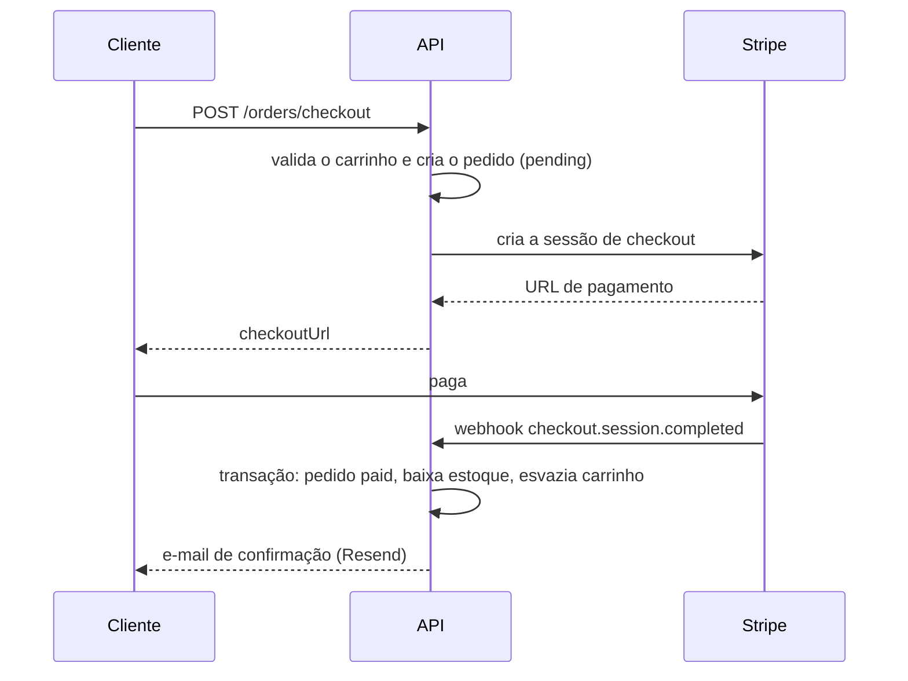

   # E-commerce API

API REST de e-commerce em **NestJS**: catálogo de produtos, carrinho, pedidos, pagamento com **Stripe**, autenticação com **Clerk** e e-mail de confirmação com **Resend**.

Projeto de estudo, construído por fases, com foco nos pontos em que um e-commerce exige consistência: dinheiro, estoque e eventos que podem chegar repetidos.

> **Status:** em desenvolvimento (versão `v0.4.0`). O backend está completo. Faltam o frontend (Next.js) e deploy.

## Stack

| Área | Tecnologia |
|---|---|
| Framework | NestJS, TypeScript |
| Banco de dados | MySQL, TypeORM |
| Autenticação | Clerk (validação de JWT no backend) |
| Pagamentos | Stripe Checkout e webhooks |
| E-mail | Resend |
| Validação | class-validator, class-transformer, Joi (variáveis de ambiente) |
| Documentação | Swagger (OpenAPI) |

## Funcionalidades

- **Catálogo:** CRUD de produtos com paginação, busca por texto e filtro por categoria. Rotas de escrita restritas a administradores. Remover um produto o **desativa**, preservando o histórico de pedidos.
- **Autenticação e autorização:** o usuário é criado no banco no primeiro acesso, a partir do token do Clerk. Dois papéis: `customer` e `admin`.
- **Carrinho:** adicionar, alterar quantidade, remover item e esvaziar, com validação de estoque e de produto ativo. O total é sempre calculado no backend.
- **Pedidos:** o checkout transforma o carrinho em um pedido, gravado em transação, com **nome e preço copiados** no momento da compra. Listagem paginada e detalhes, sempre restritos ao dono do pedido.
- **Pagamento:** o checkout cria uma sessão do Stripe e devolve a URL de pagamento.
- **Webhook do Stripe:** confirma o pagamento, baixa o estoque, esvazia o carrinho e cancela pedidos cuja sessão expirou.
- **E-mail:** confirmação do pedido (HTML e texto) enviada depois do pagamento.
- **Erros:** filtro global com formato único de resposta, conflitos de banco traduzidos em 409 e nenhum detalhe interno exposto.

## Decisões de projeto

- **Preços em centavos (inteiros):** evita erros de arredondamento e é o formato que o Stripe espera.
- **O preço nunca vem do cliente:** o body do carrinho só leva `productId` e `quantity`. O preço é lido do banco.
- **Snapshot no pedido:** `OrderItem` guarda nome e preço no momento da compra, então mudar ou desativar um produto não altera pedidos antigos.
- **Isolamento entre usuários:** carrinho e pedidos são sempre buscados pelo usuário autenticado. Pedido de outra pessoa responde 404.
- **Webhook idempotente:** a mudança de status é uma atualização condicional (`pending` para `paid`) dentro de uma transação. Se o Stripe reenviar o evento, nada é processado de novo: o estoque não baixa duas vezes e o e-mail não é duplicado.
- **Baixa de estoque condicional:** só diminui se ainda houver saldo, evitando estoque negativo. Se o estoque não cobrir um pedido já pago, o problema é registrado no log para tratamento manual.
- **E-mail isolado do pagamento:** é enviado depois do commit da transação, e uma falha no envio é apenas registrada, sem desfazer o pagamento.
- **Rota do webhook pública, protegida por assinatura:** o corpo cru da requisição é verificado com o segredo do Stripe.

## Fluxo de compra



## Endpoints

| Método | Rota | Acesso | Descrição |
|---|---|---|---|
| GET | `/products` | público | Lista produtos ativos (`page`, `limit`, `search`, `category`) |
| GET | `/products/:id` | público | Busca um produto ativo |
| POST | `/products` | admin | Cria produto |
| PATCH | `/products/:id` | admin | Atualiza ou reativa (`active: true`) |
| DELETE | `/products/:id` | admin | Desativa o produto |
| GET | `/auth/me` | logado | Usuário autenticado |
| GET | `/cart` | logado | Carrinho com subtotais e total |
| POST | `/cart/items` | logado | Adiciona produto (soma à quantidade existente) |
| PATCH | `/cart/items/:itemId` | logado | Define a quantidade de um item |
| DELETE | `/cart/items/:itemId` | logado | Remove um item |
| DELETE | `/cart` | logado | Esvazia o carrinho |
| POST | `/orders/checkout` | logado | Cria o pedido e a sessão de pagamento |
| GET | `/orders` | logado | Lista os pedidos do usuário |
| GET | `/orders/:id` | logado | Detalhes de um pedido |
| POST | `/payments/webhook` | Stripe | Recebe eventos do Stripe (assinatura obrigatória) |

A documentação interativa fica em `http://localhost:3000/api` (Swagger UI), e o documento OpenAPI em `/api-json`.

## Como rodar

### Pré-requisitos

- Node.js 24.9     ou superior
- MySQL em execução
- Contas de teste no [Clerk](https://clerk.com), no [Stripe](https://stripe.com) (modo de teste) e no [Resend](https://resend.com)
- [Stripe CLI](https://docs.stripe.com/stripe-cli) para receber webhooks localmente

### Instalação

```bash
git clone https://github.com/DeyvidNunes/ecommerce.git
cd ecommerce/api
npm install
```

### Variáveis de ambiente

Copie o `.env.example` para `.env` e preencha os valores:

```bash
cp .env.example .env
```

| Variável | Descrição |
|---|---|
| `PORT` | Porta da API (padrão 3000) |
| `DATABASE_HOST`, `DATABASE_PORT`, `DATABASE_USER`, `DATABASE_PASSWORD`, `DATABASE_NAME` | Conexão com o MySQL |
| `CLERK_SECRET_KEY` | Chave secreta do Clerk |
| `STRIPE_SECRET_KEY` | Chave secreta do Stripe (modo de teste) |
| `STRIPE_WEBHOOK_SECRET` | Segredo do webhook (`whsec_...`, impresso pelo `stripe listen`) |
| `FRONTEND_URL` | URL do frontend, usada nos redirecionamentos do Stripe |
| `RESEND_API_KEY` | Chave da API do Resend |
| `MAIL_FROM` | Remetente dos e-mails (por exemplo, `onboarding@resend.dev`) |

Confira o `.env.example` para a lista completa e atual. As variáveis são validadas na inicialização: a API não sobe se alguma obrigatória estiver faltando.

### Banco de dados

Crie o banco antes de iniciar e rode as migrations para estruturar as tabelas:

```sql
CREATE DATABASE ecommerce CHARACTER SET utf8mb4 COLLATE utf8mb4_unicode_ci;
```
```bash
npm run migration:run
```

### Migrations

O projeto utiliza o TypeORM CLI para gerenciar as alterações no banco de dados de forma versionada e segura.

```bash
# Executar as migrations pendentes no banco
npm run migration:run

# Reverter a última migration executada
npm run migration:revert

# Criar uma nova migration a partir das alterações nas @Entity()
npm run migration:generate src/database/migrations/NomeDaMigration

# Exibir a lista de migrations e o status de execução
npm run migration:show
```

### Executar
```bash
npm run start:dev
npm run seed
```

### Receber webhooks do Stripe

Em outro terminal:

```bash
stripe listen --events checkout.session.completed,checkout.session.expired --forward-to localhost:3000/payments/webhook
```

Copie o `whsec_...` impresso para `STRIPE_WEBHOOK_SECRET` e reinicie a API.

### Testar rotas protegidas sem frontend

O login acontece no frontend, então, para testar a API pelo Postman, gere um token de teste direto pela API do Clerk:

1. Crie um usuário no painel do Clerk e copie o `user_...`.
2. `POST https://api.clerk.com/v1/sessions` com `{ "user_id": "user_..." }` e a `CLERK_SECRET_KEY` como Bearer. Copie o `sess_...` da resposta.
3. `POST https://api.clerk.com/v1/sessions/sess_.../tokens` com `{}`. O campo `jwt` é o token, válido por **60 segundos**.
4. Use o `jwt` como Bearer nas rotas da API.

Para testar rotas de administrador, altere o papel do usuário no banco:

```sql
UPDATE users SET role = 'admin' WHERE id = 1;
```

### Pagar em modo de teste

Use o cartão `4242 4242 4242 4242`, com qualquer validade futura e qualquer CVC. O cartão `4000 0000 0000 0002` simula pagamento recusado.

Sem frontend, a página de retorno do Stripe (`FRONTEND_URL`) não existe, e o navegador mostrará um erro de página não encontrada depois do pagamento. O pedido é confirmado pelo webhook, e não por essa página.

## Estrutura

```
api/src
├── auth/        guard do Clerk, decorator @CurrentUser e RolesGuard
├── cart/        carrinho e itens
├── common/      filtro global de exceções
├── config/      configuração e validação de variáveis de ambiente
├── mail/        envio de e-mails (Resend)
├── orders/      checkout, pedidos e processamento do pagamento
├── payments/    sessão de checkout e webhook do Stripe
├── products/    catálogo
└── users/       usuários sincronizados com o Clerk
```

## Versões

| Versão | Conteúdo |
|---|---|
| `v0.1.0` | Catálogo e autenticação com Clerk |
| `v0.2.0` | Carrinho e pedidos |
| `v0.3.0` | Pagamento com Stripe e webhook |
| `v0.4.0` | E-mails com Resend |

O desenvolvimento segue o fluxo de uma branch por funcionalidade, com Pull Request e commits no padrão `tipo(escopo): descrição`.

## Próximos passos

- [ ] CORS e rate limiting
- [ ] Testes automatizados dos fluxos principais (carrinho, checkout e webhook)
- [ ] Frontend em Next.js
- [ ] Deploy
