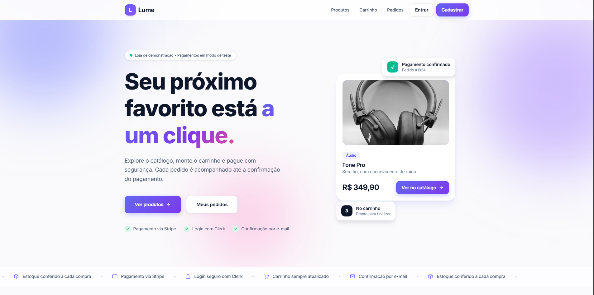
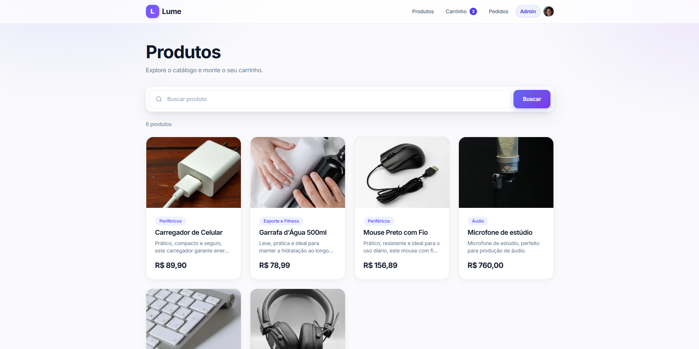
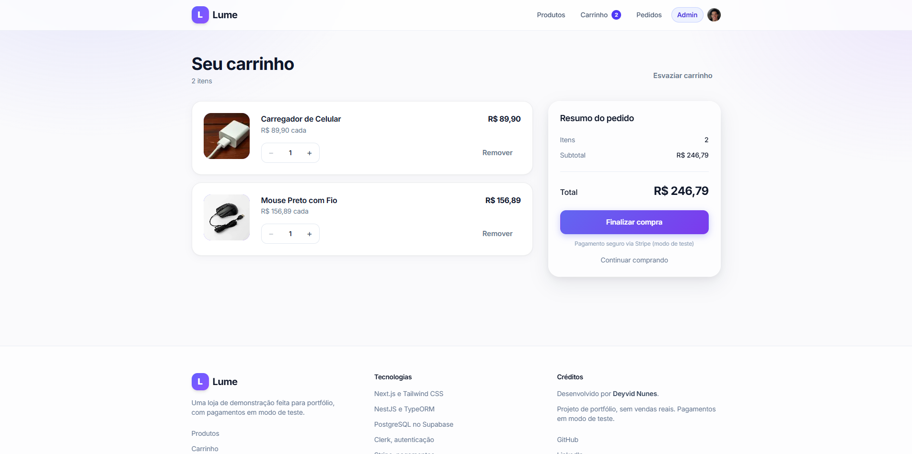
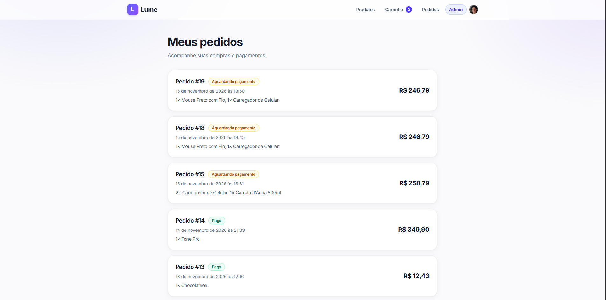
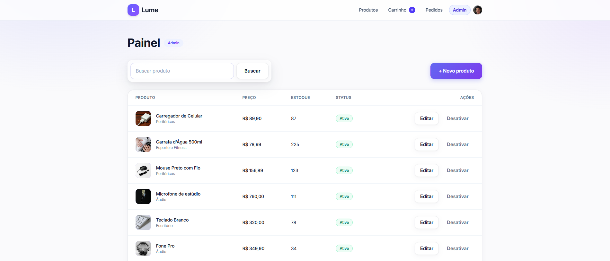
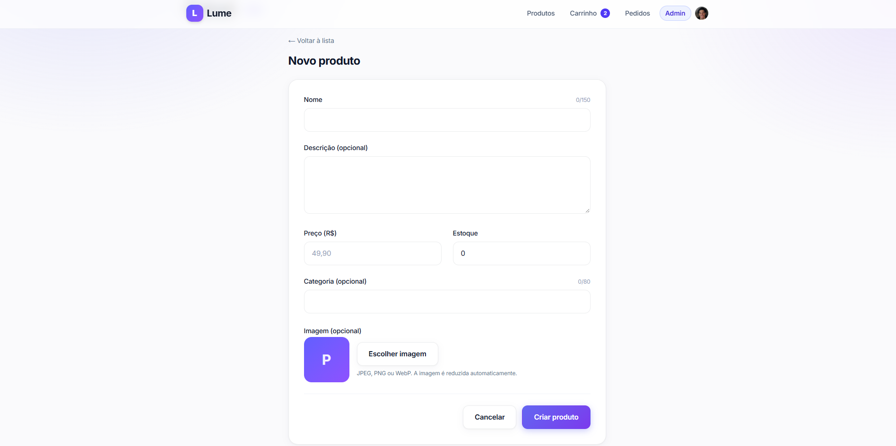
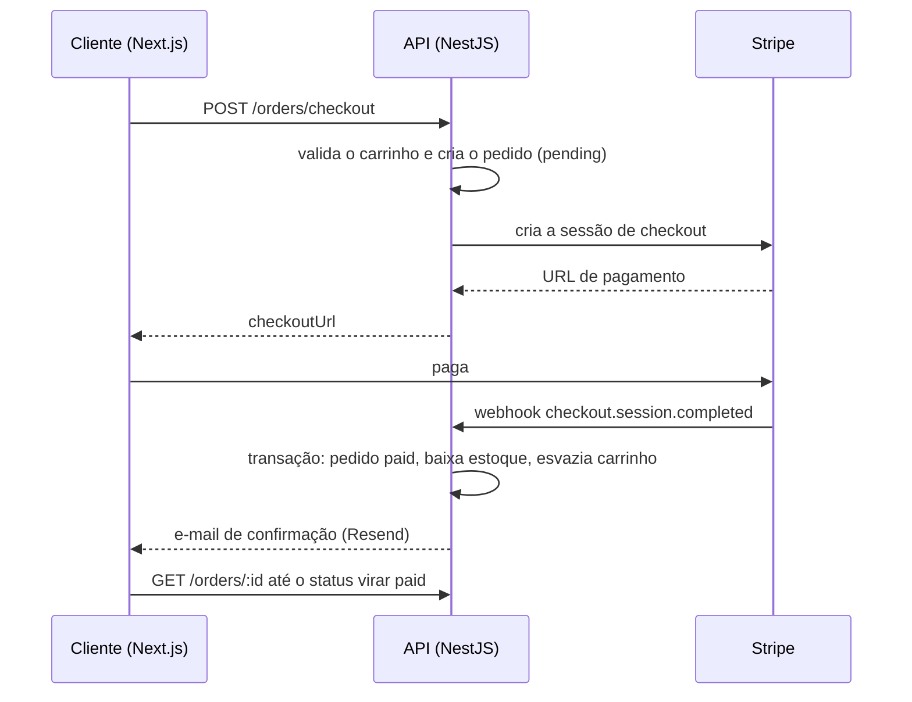

# Lume

E-commerce fullstack de demonstração: catálogo, carrinho, pagamento com **Stripe**, pedidos confirmados por **webhook**, autenticação com **Clerk**, e-mail com **Resend** e painel de administração. API em **NestJS**, frontend em **Next.js**.

Projeto de estudo e de portfólio, construído por fases, com foco nos pontos em que um e-commerce exige consistência: dinheiro, estoque e eventos que podem chegar repetidos.

> **Os pagamentos rodam em modo de teste. Não há vendas reais.**

| | |
|---|---|
| **Site** | `<URL-DO-SITE-NA-VERCEL>` |
| **API** | `<URL-DA-API-NO-RENDER>` (a rota `/health` mostra se está de pé) |
| **Código** | https://github.com/DeyvidNunes/ecommerce |

> A API roda no plano gratuito do Render e **dorme depois de 15 minutos sem uso**: a primeira chamada pode levar cerca de um minuto. Veja [Limitações conhecidas](#limitações-conhecidas).

## Telas

<!-- Salve os prints em docs/screenshots/ e ajuste os nomes abaixo -->

| Página inicial | Catálogo |
|---|---|
|  |  |

| Carrinho | Pedido pago |
|---|---|
|  |  |

| Painel admin | Formulário de produto |
|---|---|
|  |  |

## Contexto, problema e solução

**Contexto.** Quis construir um projeto que passasse por todas as etapas de uma loja online de verdade, e não só telas: autenticação, dinheiro, estoque, e-mail e deploy.

**Problema.** Numa compra online o preço não pode ser decidido pelo navegador, o pagamento acontece em outro sistema e a confirmação chega depois, de forma assíncrona, podendo chegar repetida.

**Solução.**
- O servidor é a única fonte dos preços: o cliente nunca envia valores, e cada pedido guarda uma cópia do nome e do preço do momento da compra.
- O pagamento acontece na página do Stripe Checkout, e o pedido só vira `paid` quando o **webhook** (com assinatura verificada) chega, nunca pela tela de sucesso.
- O webhook é idempotente: o Stripe pode reenviar o evento sem baixar o estoque nem mandar e-mail duas vezes.

## Stack

| Área | Tecnologia |
|---|---|
| Frontend | Next.js 16 (App Router), TypeScript, Tailwind CSS |
| Backend | NestJS, TypeScript |
| Banco de dados | PostgreSQL (Supabase), TypeORM com migrations (sem `synchronize`) |
| Autenticação | Clerk (validação de JWT no backend) |
| Pagamentos | Stripe Checkout e webhooks |
| E-mail | Resend |
| Imagens | Supabase Storage (bucket público, escrita só pela API) |
| Validação | class-validator, class-transformer, Joi (variáveis de ambiente) |
| Documentação | Swagger (OpenAPI), fora de produção |
| Deploy | Render (API), Vercel (frontend), Supabase (banco e imagens) |

## Funcionalidades

**Cliente**
- **Catálogo:** busca por nome e paginação, com cache de 60 segundos na leitura pública.
- **Carrinho:** adicionar, alterar quantidade (1 a 99), remover e esvaziar, com validação de estoque e de produto ativo e contador no cabeçalho. O total é sempre calculado no backend.
- **Pedidos:** o checkout transforma o carrinho em um pedido, gravado em transação, com **nome e preço copiados** no momento da compra. Listagem paginada e detalhes, sempre restritos ao dono do pedido. A página de retorno acompanha o status até a confirmação do pagamento.
- **E-mail:** confirmação do pedido (HTML e texto) enviada depois do pagamento.

**Administração** (papel `admin`)
- Criar, editar, desativar e reativar produtos. Remover um produto o **desativa**, preservando o histórico de pedidos.
- Envio de imagem do produto, com compressão no navegador antes do envio.

**Plataforma**
- **Autenticação e autorização:** o usuário é criado no banco no primeiro acesso, a partir do token do Clerk. Dois papéis: `customer` e `admin`.
- **Webhook do Stripe:** confirma o pagamento, baixa o estoque, esvazia o carrinho e cancela pedidos cuja sessão expirou.
- **Erros:** filtro global com formato único de resposta, conflitos de banco traduzidos em 409 e nenhum detalhe interno exposto.

## Decisões de projeto

- **Preços em centavos (inteiros):** evita erros de arredondamento e é o formato que o Stripe espera. No admin, o valor digitado em reais é convertido sem ponto flutuante.
- **O preço nunca vem do cliente:** o body do carrinho só leva `productId` e `quantity`, e o checkout não recebe valores. O preço é lido do banco.
- **Snapshot no pedido:** `OrderItem` guarda nome e preço no momento da compra, então mudar ou desativar um produto não altera pedidos antigos.
- **Isolamento entre usuários:** carrinho e pedidos são sempre buscados pelo usuário autenticado. Pedido de outra pessoa responde 404.
- **Webhook idempotente:** a mudança de status é uma atualização condicional (`pending` para `paid`) dentro de uma transação. Se o Stripe reenviar o evento, nada é processado de novo: o estoque não baixa duas vezes e o e-mail não é duplicado.
- **Baixa de estoque condicional:** só diminui se ainda houver saldo, evitando estoque negativo. Se o estoque não cobrir um pedido já pago, o problema é registrado no log para tratamento manual (veja [Limitações conhecidas](#limitações-conhecidas)).
- **E-mail isolado do pagamento:** é enviado depois do commit da transação, e uma falha no envio é apenas registrada, sem desfazer o pagamento.
- **Rota do webhook pública, protegida por assinatura:** o corpo cru da requisição é verificado com o segredo do Stripe.
- **Segurança da API:** `helmet` e `trust proxy` em produção, CORS restrito ao endereço do frontend, rate limiting (100 por minuto no geral, 5 por minuto no checkout) e validação das variáveis de ambiente na inicialização.
- **Upload de imagem:** o tipo do arquivo é conferido pelos primeiros bytes (JPEG, PNG ou WebP), SVG é recusado, o nome do arquivo é gerado pela API e o limite é de 2 MB. A chave secreta do storage fica só no servidor.
- **Frontend:** o catálogo público é lido no servidor, com cache; carrinho, checkout, pedidos e admin são chamados do navegador com o token do usuário. A guarda de admin no frontend é só conforto de interface, e a barreira real é o `RolesGuard` da API.

## Fluxo de compra



## Endpoints

| Método | Rota | Acesso | Descrição |
|---|---|---|---|
| GET | `/health` | público | Verificação de saúde |
| GET | `/products` | público | Lista produtos ativos (`page`, `limit`, `search`, `category`) |
| GET | `/products/:id` | público | Busca um produto ativo |
| POST | `/products` | admin | Cria produto |
| PATCH | `/products/:id` | admin | Atualiza ou reativa (`active: true`) |
| DELETE | `/products/:id` | admin | Desativa o produto |
| GET | `/products/admin` | admin | Lista produtos, inclusive desativados |
| GET | `/products/admin/:id` | admin | Busca um produto, inclusive desativado |
| POST | `/products/:id/image` | admin | Envia ou troca a imagem (multipart, JPEG, PNG ou WebP, até 2 MB) |
| GET | `/auth/me` | logado | Usuário autenticado |
| GET | `/cart` | logado | Carrinho com subtotais e total |
| POST | `/cart/items` | logado | Adiciona produto (soma à quantidade existente) |
| PATCH | `/cart/items/:itemId` | logado | Define a quantidade de um item |
| DELETE | `/cart/items/:itemId` | logado | Remove um item |
| DELETE | `/cart` | logado | Esvazia o carrinho |
| POST | `/orders/checkout` | logado | Cria o pedido e a sessão de pagamento |
| GET | `/orders` | logado | Lista os pedidos do usuário |
| GET | `/orders/:id` | logado | Detalhes de um pedido |
| POST | `/payments/webhook` | Stripe | Recebe eventos do Stripe (assinatura obrigatória) |

Fora de produção, a documentação interativa fica em `http://localhost:3000/api` (Swagger UI), e o documento OpenAPI em `/api-json`.

## Como rodar

### Pré-requisitos

- Node.js 24.9 ou superior
- PostgreSQL em execução (local ou no Supabase)
- Contas de teste no [Clerk](https://clerk.com), no [Stripe](https://stripe.com) (modo de teste), no [Resend](https://resend.com) e no [Supabase](https://supabase.com), com um bucket público de Storage chamado `product-images`
- [Stripe CLI](https://docs.stripe.com/stripe-cli) para receber webhooks localmente

### Instalação

```bash
git clone https://github.com/DeyvidNunes/ecommerce.git
cd ecommerce/api
npm install
```

### Variáveis de ambiente da API

Copie o `.env.example` para `.env` e preencha os valores:

```bash
cp .env.example .env
```

| Variável | Descrição |
|---|---|
| `PORT` | Porta da API (padrão 3000) |
| `NODE_ENV` | Ambiente (`development` ou `production`) |
| `DATABASE_HOST`, `DATABASE_PORT`, `DATABASE_USER`, `DATABASE_PASSWORD`, `DATABASE_NAME` | Conexão com o PostgreSQL (no pooler do Supabase, o usuário é `postgres.<ref>` e o banco é `postgres`) |
| `DATABASE_SSL`, `DATABASE_SSL_CA` | SSL da conexão e certificado |
| `DATABASE_POOL_SIZE` | Tamanho do pool de conexões |
| `CLERK_SECRET_KEY` | Chave secreta do Clerk (a mesma aplicação do frontend) |
| `STRIPE_SECRET_KEY` | Chave secreta do Stripe (modo de teste) |
| `STRIPE_WEBHOOK_SECRET` | Segredo do webhook (`whsec_...`) |
| `FRONTEND_URL` | Endereço exato do frontend, sem barra no final (CORS e redirecionamentos do Stripe) |
| `RESEND_API_KEY` | Chave da API do Resend |
| `MAIL_FROM` | Remetente dos e-mails (por exemplo, `onboarding@resend.dev`) |
| `SUPABASE_URL` | Endereço do projeto no Supabase |
| `SUPABASE_SECRET_KEY` | Chave secreta do Supabase (usada só para gravar imagens) |
| `SUPABASE_STORAGE_BUCKET` | Nome do bucket (padrão `product-images`) |

Confira o `.env.example` para a lista completa e atual. As variáveis são validadas na inicialização: a API não sobe se alguma obrigatória estiver faltando.

### Banco de dados

Em um PostgreSQL local, crie o banco antes (no Supabase, ele já existe):

```sql
CREATE DATABASE ecommerce;
```

```bash
npm run migration:run
```

### Migrations

O projeto utiliza o TypeORM CLI para gerenciar as alterações no banco de dados de forma versionada e segura.

```bash
# Executar as migrations pendentes no banco
npm run migration:run

# Reverter a última migration executada
npm run migration:revert

# Criar uma nova migration a partir das alterações nas @Entity()
npm run migration:generate src/database/migrations/NomeDaMigration

# Exibir a lista de migrations e o status de execução
npm run migration:show
```

### Executar a API

```bash
npm run start:dev
npm run seed
```

### Receber webhooks do Stripe

Em outro terminal:

```bash
stripe listen --events checkout.session.completed,checkout.session.expired --forward-to localhost:3000/payments/webhook
```

Copie o `whsec_...` impresso para `STRIPE_WEBHOOK_SECRET` e reinicie a API. Esse segredo vale só para o ambiente local: no deploy, vale o segredo do destino de webhook cadastrado no painel do Stripe.

### Frontend

```bash
cd ../web
cp .env.example .env.local
npm install
npm run dev
```

| Variável | Descrição |
|---|---|
| `NEXT_PUBLIC_API_URL` | Endereço da API |
| `NEXT_PUBLIC_CLERK_PUBLISHABLE_KEY` | Chave pública do Clerk |
| `CLERK_SECRET_KEY` | Chave secreta do Clerk |
| `NEXT_PUBLIC_IMAGES_HOST` | Domínio das imagens (host do Supabase, sem `https://`) |

Se a API e o frontend rodarem na mesma máquina, use portas diferentes (por exemplo, a API na 3000 e o frontend com `npm run dev -- -p 3001`), e `FRONTEND_URL` com o endereço do frontend.

### Primeiro administrador

Cadastre um usuário pelo site e altere o papel dele direto no banco:

```sql
UPDATE users SET role = 'admin' WHERE id = 1;
```

### Pagar em modo de teste

Use o cartão `4242 4242 4242 4242`, com qualquer validade futura e qualquer CVC. O cartão `4000 0000 0000 0002` simula pagamento recusado. O pedido é confirmado pelo webhook, e não pela página de retorno.

### Testar a API sem o frontend

O login acontece no frontend, então, para testar rotas protegidas pelo Postman ou pelo Swagger, gere um token de teste direto pela API do Clerk:

1. Crie um usuário no painel do Clerk e copie o `user_...`.
2. `POST https://api.clerk.com/v1/sessions` com `{ "user_id": "user_..." }` e a `CLERK_SECRET_KEY` como Bearer. Copie o `sess_...` da resposta.
3. `POST https://api.clerk.com/v1/sessions/sess_.../tokens` com `{}`. O campo `jwt` é o token, válido por **60 segundos**.
4. Use o `jwt` como Bearer nas rotas da API.

## Estrutura

```
ecommerce/
├── api/src
│   ├── auth/        guard do Clerk, decorator @CurrentUser e RolesGuard
│   ├── cart/        carrinho e itens
│   ├── common/      filtro global de exceções
│   ├── config/      configuração e validação de variáveis de ambiente
│   ├── mail/        envio de e-mails (Resend)
│   ├── orders/      checkout, pedidos e processamento do pagamento
│   ├── payments/    sessão de checkout e webhook do Stripe
│   ├── products/    catálogo e upload de imagem
│   ├── storage/     envio de arquivos ao Supabase Storage
│   └── users/       usuários sincronizados com o Clerk
└── web/src
    ├── app/         páginas (início, produtos, carrinho, pedidos e admin)
    ├── components/  cabeçalho, rodapé, cartões, formulário de produto
    ├── hooks/       acesso à API com token e usuário atual
    └── lib/         cliente da API, tipos e formatação
```

## Deploy

- **API (Render, plano gratuito):** build com `npm ci --include=dev`; o comando de início roda `migration:run:prod` antes de `start:prod`.
- **Banco e imagens (Supabase):** conexão pelo pooler em modo sessão, com SSL.
- **Frontend (Vercel):** *Root Directory* apontando para `web`, com as variáveis do frontend cadastradas no painel. Variáveis `NEXT_PUBLIC_*` são gravadas no build: depois de mudar uma, faça um novo deploy.
- **Ligação entre as duas pontas:** `FRONTEND_URL` na API deve ser a origem exata do frontend.
- **Stripe:** destino de webhook no painel apontando para `<URL-DA-API>/payments/webhook`, formato *Snapshot*, na mesma conta da chave `sk_test`, inscrito em `checkout.session.completed` e `checkout.session.expired`.

## Testes

- **Unitários (Jest):** carrinho, checkout, `processOrderPayment`, `cancelPendingOrder` e detecção do tipo de imagem enviada. Rodam com `npm test`, na pasta `api`.
- **Roteiro manual de ponta a ponta**, executado com o cartão de teste: compra completa; o pedido só vira `paid` pelo webhook; reenvio do evento sem efeito duplicado; pagamento recusado mantendo carrinho e pedido pendente; rotas de pedidos recusadas sem login (401); painel e rotas de admin recusados para `customer` (403); pedido de outro usuário respondendo 404.

## Limitações conhecidas

- **Dois clientes podem pagar pelo último item.** A conferência de estoque acontece antes do pagamento, e o pagamento pode demorar. Se dois checkouts abertos ao mesmo tempo passarem pela conferência, os dois pagamentos são aprovados e os dois pedidos ficam `paid`. O estoque nunca fica negativo (a baixa é condicional) e o caso é registrado no log para tratamento manual, mas não há cancelamento nem reembolso automático. Evoluções possíveis: reembolsar pela API do Stripe quando o estoque for insuficiente no webhook, ou reservar o estoque no checkout.
- **O e-mail de confirmação só chega ao endereço da conta do Resend**, porque não há domínio verificado. O pedido funciona normalmente para qualquer outro usuário; só o e-mail não é entregue.
- **A primeira chamada pode demorar** (API gratuita que dorme) e o **banco gratuito do Supabase pausa depois de uma semana sem atividade**. Se o site não responder, reative o projeto no painel do Supabase.
- **O CORS aceita uma origem só**, então as URLs de pré-visualização da Vercel são bloqueadas; só o domínio de produção funciona.
- **Clerk em instância de desenvolvimento:** o aviso de chaves de desenvolvimento aparece no console do navegador.
- **As chamadas feitas pelo servidor do Next compartilham um IP** no rate limiting; por isso o catálogo é lido com cache.
- **As imagens não são reprocessadas na API.** A redução de tamanho e a remoção de metadados acontecem no navegador, antes do envio.

## Versões

| Versão | Conteúdo |
|---|---|
| `v0.1.0` | Catálogo e autenticação com Clerk |
| `v0.2.0` | Carrinho e pedidos |
| `v0.3.0` | Pagamento com Stripe e webhook |
| `v0.4.0` | E-mails com Resend |

<!-- Acrescente as versões seguintes conforme `git tag` (v0.5.0, v0.6.0...) -->

O desenvolvimento segue o fluxo de uma branch por funcionalidade, com Pull Request e commits no padrão `tipo(escopo): descrição`.

## Próximos passos

- [x] CORS e rate limiting
- [x] Testes automatizados dos fluxos principais (carrinho, checkout e webhook)
- [x] Frontend em Next.js
- [ ] Deploy do frontend e teste de ponta a ponta no site publicado
- [ ] Reembolso automático (ou reserva de estoque) para o caso do último item
- [ ] Domínio verificado no Resend, para entregar e-mails a qualquer usuário

## Autor

Feito por **Deyvid Nunes**, estudante de Ciência da Computação na UFAPE. [GitHub](https://github.com/DeyvidNunes)
